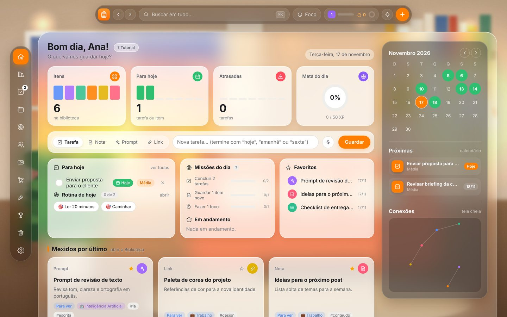
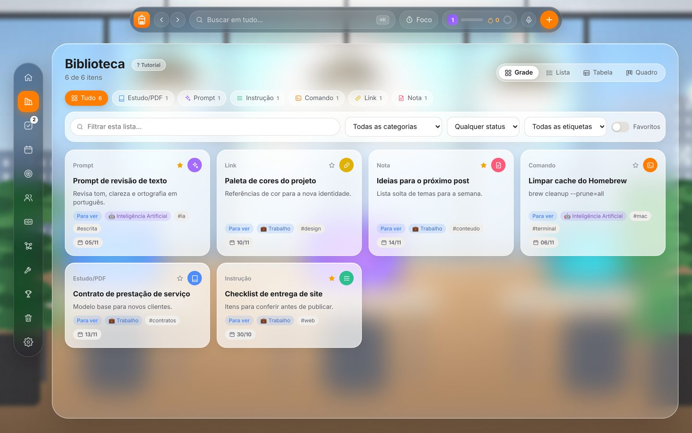

# Backpack

Inventário pessoal para Mac e Windows: guarde PDFs, prompts, instruções, comandos, links e notas, organize
tarefas, rotina, clientes e finanças, e ache tudo rápido. Roda 100% no seu computador, sem conta e sem nuvem.



**Precisa de:** Mac com macOS 12 ou mais novo, ou Windows 10/11, e o [Node.js](https://nodejs.org) (versão LTS). É grátis e open source.

## Baixar e instalar

**Jeito mais simples (recomendado).** Instale o [Node.js](https://nodejs.org) (botão "LTS"). Depois abra o
**Terminal** (Cmd+Espaço, digite "Terminal"), cole a linha abaixo e aperte Enter:

```
git clone https://github.com/aciolijacques-tech/backpack.git ~/Documents/Backpack && open ~/Documents/Backpack/"Instalar Backpack.app"
```

- Se o Mac pedir para instalar as **Ferramentas de Linha de Comando**, aceite (é gratuito, da Apple),
  espere terminar e cole a linha de novo.
- O instalador abre sozinho. Pronto: o **Backpack** fica em Aplicativos e no Launchpad. Para deixar no Dock:
  botão direito no ícone → Opções → Manter no Dock.

**Pelo ZIP (sem Terminal para baixar).** Botão verde **Code → Download ZIP**, descompacte, renomeie a pasta
para `Backpack` e mova para Documentos **antes** de instalar. Como o macOS bloqueia apps baixados pelo
navegador, abra o Terminal, digite `xattr -dr com.apple.quarantine ` (com o espaço no fim), arraste a pasta
do Backpack para a janela do Terminal e aperte Enter. Depois, dois cliques em **Instalar Backpack**. Se o
macOS ainda reclamar: Ajustes do Sistema → Privacidade e Segurança → "Abrir mesmo assim".

O servidor liga sozinho quando você entra no Mac. Se mover ou renomear a pasta, abra o instalador de novo.
**Atualizações** chegam sozinhas: o app avisa quando sai versão nova e atualiza com um clique.
Para remover: `Desinstalar.command` (não apaga seus dados).
Se algo der errado, os detalhes ficam em `data/logs/instalacao.log`; use o botão **Reportar problema**
no app ou abra uma [issue](https://github.com/aciolijacques-tech/backpack/issues).

## Instalar no Windows (10 e 11)
1. Instale o [Node.js](https://nodejs.org) (botão "LTS").
2. Botão verde **Code → Download ZIP**, descompacte, renomeie a pasta para `Backpack` e deixe em
   Documentos **antes** de instalar.
3. Dois cliques em **Instalar Backpack.cmd**. Se o Windows mostrar "O Windows protegeu o computador",
   clique em **Mais informações → Executar assim mesmo**.

Pronto: o **Backpack** fica no Menu Iniciar e na Área de Trabalho e abre numa janela própria (usa o Edge,
que já vem no Windows). O servidor liga sozinho quando você entra no Windows. Para remover:
`Desinstalar Backpack.cmd` (não apaga seus dados). Se mover a pasta, rode o instalador de novo.

## O que tem


- **Biblioteca** em grade, lista, tabela ou quadro (arraste cartões entre colunas), com categorias,
  etiquetas, favoritos, checklist, links e anexos (ver, baixar, abrir no Mac)
- **Tarefas** com data escrita no texto ("pagar conta amanhã", "reunião sexta") e **calendário**
  com arrastar para remarcar
- **Busca em tudo** com `Cmd+K`, inclusive nomes de anexos, e comandos rápidos
- **Leitor** de `.md` e `.txt` em blocos fáceis de ler
- **Mapa de conexões** entre itens (etiquetas, categoria, menções com `[[Título]]`)
- **IA dentro dos itens**: melhorar, corrigir, resumir e mais, usando o Claude Code ou o Codex que já
  estão no seu Mac (sem chave) ou uma chave da API do Claude
- **Modo foco** com aviso do macOS no fim, **XP, níveis, missões e conquistas** (tudo desligável)
- **Notion, Trello e Google Drive**, **vidro claro ou escuro**, backup e restauração
- **Rotina**: hábitos com sequência de dias e metas com progresso
- **Clientes**: contatos, funil e tudo do cliente junto (tarefas, itens e lançamentos)
- **Financeiro**: entradas e saídas do mês, contas que repetem, parcelas, calculadora de preço, CSV
- **Tarefas que repetem** e **lembrete com horário** (o Mac avisa, mesmo com a janela fechada)
- **Voz**: fale em vez de digitar e crie itens falando. A transcrição roda no seu Mac; na primeira
  vez ele baixa o motor de voz (uns 80 MB)
- **Usar no celular** pela rede Wi-Fi de casa, com QR Code e código de 6 números (e HTTPS opcional,
  para o microfone)
- **23 kits prontos** (briefings, contratos, proposta, vendas e lançamento), cada um com PDF
- **Rascunho** nas fichas, **voltar/avançar** e **modelos** no "Novo item"
- **Backup com senha**, **exportar para o Obsidian** e **conexões** para outros programas mandarem itens
- **Tutorial** em cada tela e botão para **reportar problema**
- **Aviso automático** quando sai versão nova, e atualização com um clique

## Seus dados
Tudo fica em `data/`, dentro da pasta do app, e nunca vai para o GitHub:
`db.json` (itens, tarefas, clientes, financeiro e rotina), `anexos/`, `backups/` (um por dia),
`segredos.json` (chaves), `rede.json` (código do celular) e `conexoes.json` (códigos dos programas).

## Atalhos
`Cmd+K` busca · `N` novo item · `H` Início · `B` Biblioteca · `T` Tarefas · `C` Calendário ·
`R` Rotina · `M` Mapa · `F` foco · `V` criar por voz · `⌘[` `⌘]` voltar e avançar · `Esc` fecha ·
clique direito no cartão abre o menu.

## Limitações conhecidas
- Windows: suporte novo, ainda em teste. Linux não é suportado.
- Windows: o microfone usa o do Edge (pede permissão); o modo seguro do celular (HTTPS, para o
  microfone) precisa do Git para Windows instalado (traz o `openssl`) — sem ele, o celular continua
  entrando normalmente pelo HTTP; atalhos de teclado usam Ctrl no lugar de Cmd.
- Sem assinatura da Apple: o macOS pede confirmação na primeira abertura do instalador.
- Para instalar, o Mac precisa das Ferramentas de Linha de Comando da Apple.
- Pensado para uma pessoa. Janelas e celular abertos juntos se sincronizam a cada 4 s; se a mesma
  coisa mudar nos dois ao mesmo tempo, fica a versão de quem salvou por último.
- **Celular**: a conexão padrão é HTTP (simples, sem instalar nada). Para microfone no celular, dá
  para usar a conexão HTTPS com um certificado criado no seu computador; na primeira vez o celular
  avisa "conexão não privada", e instalando o certificado do Backpack (link na tela de entrar) o
  aviso some. Fora de casa, não funciona (a não ser por VPN, como o Tailscale).
- **Voz** precisa de internet na primeira vez (baixa o motor) e da permissão de microfone do macOS.
- Os contratos dos kits são modelos de referência: revise com um advogado antes de usar.

## Para quem desenvolve
Node.js puro, sem dependências. A janela do Mac é `mac/Backpack.swift`; a do Windows, `windows/abrir.vbs` (Edge em modo app). O que muda por sistema fica em `lib/sistema.js`. `node server.js` roda; `node --test` testa (com dados temporários).
Regras do projeto em `CLAUDE.md`, decisões em `docs/decisoes/`, specs em `docs/specs/`.
Para publicar uma versão: suba `versao` e `novidades` em `versao.json` e dê push no `master`.

## Licença e créditos
Inspirado no [MyLoot](https://github.com/edirsooo/myloot), com código e visual próprios.
MIT — ver `LICENSE`. Os textos-base dos 23 kits e o gerador de QR Code vêm do
[MyLoot](https://github.com/edirsooo/myloot) (MIT, © 2026 Prestes Design), adaptados para o Backpack.
